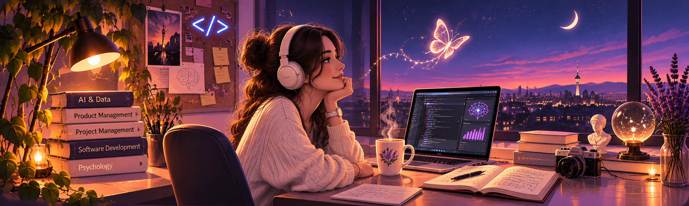

<!-- HERO IMAGE -->                                                       

  

 

<!-- SPARKLING NAME -->

  

<!-- TYPING ROLE -->

  

 

  <em>Building meaningful solutions through Software, AI & Product Thinking</em>

 

<!-- TECH STACK -->

  

  

  
  
  

## 🌱 My Story

I'm a Computer Engineer with experience in Software Development, Artificial Intelligence, Enterprise Software and Product & Project Management.

I work on B2B, CRM and ERP-integrated applications, focusing on software development, business requirements analysis, technical solutions and project coordination.

For me, technology is more than writing code. It's about **creating meaningful solutions, solving real-world problems and building products that make a difference.**

---

## 🎯 What I Work On

- 💻 **Software Development:** Enterprise web and mobile applications, ERP/CRM and B2B systems
- 🤖 **AI & Data:** Machine Learning, NLP, Data Analytics and Automation
- 🚀 **Product & Project Management:** Requirements Analysis, Product Development, Process Tracking and Team Coordination

---

## 🚀 Featured Projects

### 🎓 Kutup | AI-Powered Employee Performance Analytics
**Undergraduate Capstone Project | IEEE SIU 2026**

Kutup is an AI-powered decision support system that evaluates employee performance using KPIs, 360-degree feedback, and survey data. By leveraging Machine Learning and Natural Language Processing (NLP), it provides managers with employee and department performance reports, predictive insights, risk assessments, and actionable recommendations to support informed decision-making.

### 📊 SmartEdu | AI-Powered Personalized Education
**TÜBİTAK 2209-A Supported Project**

SmartEdu is an AI-powered mobile learning application designed for primary school students with disabilities. Built with Flutter, it combines personalized educational content with accessible learning approaches tailored to individual needs and learning styles.

### 💻 Field Sales, Mobile CRM & Pano ERP Projects

Enterprise software solutions designed to digitalize business operations. The field sales application supports sales activities, the mobile CRM solution facilitates customer relationship management and Pano ERP addresses industry-specific workflows in the electrical panel sector. Together, these applications support more efficient business processes across web and mobile platforms.

### 🤖 Data Engineering & Artificial Intelligence Projects

A collection of projects focused on data processing, customer analytics and intelligent support systems. These include data pipelines built with Apache Airflow, dbt and PostgreSQL; Machine Learning models for customer segmentation and churn prediction and NLP-based sentiment analysis and AI-powered customer support solutions.

## ✨ How I Define Myself

  
  
  

  
  
  

## 💡 My Interests

- 🌍 Developing technologies that make human life easier  
- 🎓 Supporting **equal opportunities in education** through AI  
- 🤖 Using artificial intelligence in **meaningful and ethical scenarios**  
- 🤝 Being active in communities with team spirit and volunteering  
- 🎨 Combining **software, art, poetry and psychology**

## 📊 GitHub Activity & Insights

Explore my repositories, open-source contributions, and development journey on GitHub.

🔗 [View My GitHub Profile](https://github.com/cansuyildirimmm)

---

## 🚀 Mission Control

## 🌱 Communities & Leadership

- 🌟 **Google AI & Technology Academy** – Scholar & project developer  
- 🚀 **Google Developer Student Clubs Turkey** – Core Team  
- 🌿 **YetGen Education Program** – 2 terms Education Leadership  
- 🧭 **IEEE ISTÜN CS Community** – Mentor & Software Developer  
- 🏢 Industry experience through **AI, Data Engineering & Software internships**

I enjoy **leading, mentoring and building together**.

## 🎭 Beyond Code

- ✍️ I write poetry — words help me understand people  
- 🧠 I’m interested in psychology and human behavior  
- 🔄 I strive to become a better version of myself every day  
- 💙 I see technology not only as code but as a way to **touch lives**

## 🌐 Let’s Connect

  
  

  

🦋 <strong>There is a human in my code.</strong> 
In every line; a solution, a hope, a piece of me.

